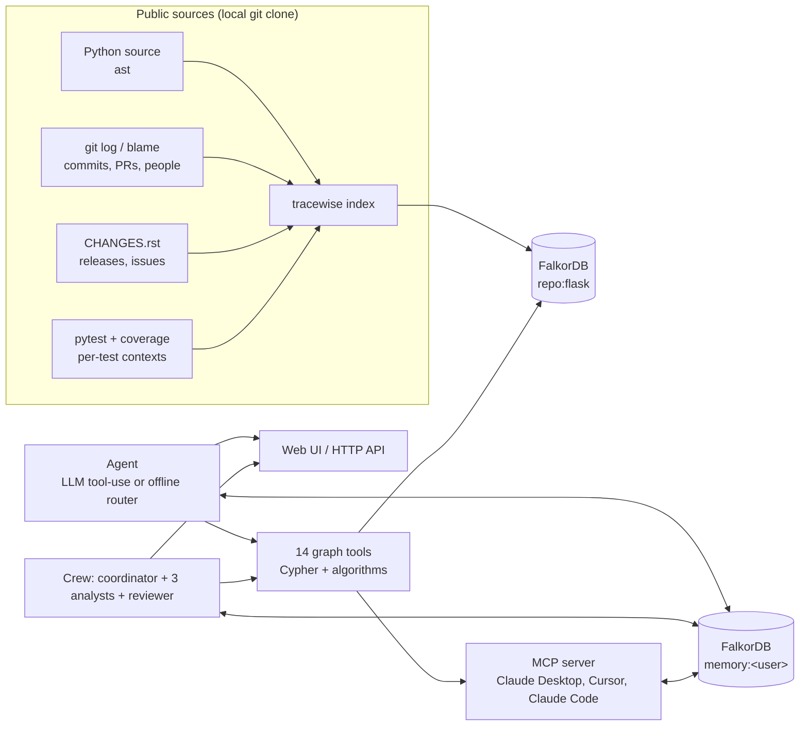
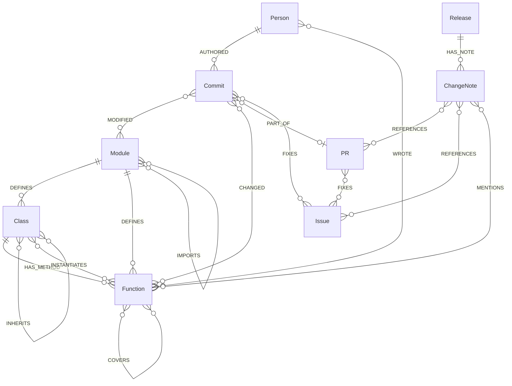
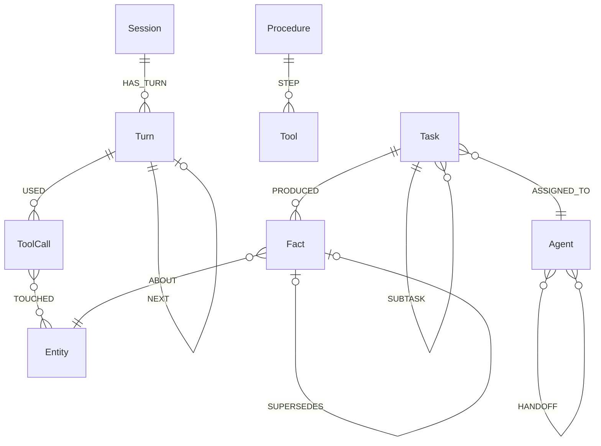

# Tracewise

**An engineering agent that knows how a codebase connects: code, history, people and decisions, in one FalkorDB graph.**

Ask *"what breaks if I change this?"*, *"who should review it?"*, *"why is it built this way?"* or *"which tests do I run?"*, and Tracewise answers by walking a graph, then shows you the path it walked and the Cypher it ran.

Built for **Graph Hacks: Context for AI Agents** (WeMakeDevs × FalkorDB, Oct 2026). Primary track: **01 · Agents That Act on Connected Data**; also entered in 02 and 03, as described below.

### Submission at a glance

| | |
|---|---|
| **Demo video** | <!-- paste your YouTube link here --> *link coming* |
| **Tracks entered** | 01 · Agents That Act on Connected Data · 02 · Agent Memory and Coordination · 03 · Company Brain ([how each is covered](#how-tracewise-covers-each-track)) |
| **Run it** | `docker compose up --build`, then open http://localhost:8000 ([Quick start](#quick-start)) |
| **Deployment** | No hosted demo; the [local setup](#quick-start) is complete and runs on Windows, macOS and Linux with Docker. A one-container image and `render.yaml` are included if you want to host it. |
| **Graph data model** | [Graph data model](#graph-data-model): one repository graph per codebase, one memory graph per user |
| **Cypher and algorithms** | [docs/QUERIES.md](docs/QUERIES.md): every query and graph algorithm the product depends on |
| **AI assistance** | Disclosed in [Use of AI coding assistants](#use-of-ai-coding-assistants) |

### The core workflow: reviewing a change

A developer is about to change `url_for`. Tracewise answers, from one graph:

1. **What breaks:** the transitive callers (multi-hop `CALLS`), including callers of overridden base-class methods.
2. **What to run:** the tests that *measurably execute* the change (coverage edges, not guesses), as a ready-made `pytest` command.
3. **Why it's like this:** the commits whose lines survive today → their PRs → the issues they fixed → the release notes that explained them.
4. **Who to ask:** a recommendation built from separate, visible signals (surviving authorship, nearby code, recent module work, merged PRs), with inactive contributors down-weighted.
5. **What changed since last time:** memory from earlier sessions. If the graph now disagrees with what the agent told you before, it says what changed.

Every step shows its evidence subgraph and the exact Cypher it ran. The same workflow runs as a crew of agents that coordinate only through the graph (Crew review), and as MCP tools inside Claude, Cursor or any MCP client.

### How Tracewise covers each track

All three run on the same FalkorDB instance: one code graph per repository (`repo:<name>`) and one memory graph per user (`memory:<user>`). In the UI, each tab and each example question carries a tag (**T1**, **T2**, **T3**) saying which track it demonstrates.

| Track | What Tracewise does for it | See it in the UI | Queries behind it |
|---|---|---|---|
| **01 · Agents That Act on Connected Data** | Multi-hop impact analysis, shortest paths, PageRank / betweenness / community detection as agent tools, MCP tool selection, and an action: a review plan for a diff (risk, reviewers, tests to run). Every answer shows the subgraph it came from. | **Ask** tab (T1): *"What breaks if I change full_dispatch_request?"*, *"Which tests cover url_for?"*, *"How is wsgi_app connected to handle_user_exception?"*, *"What are the riskiest parts of the codebase?"*. Open the **Cypher** drawer under the graph. | [QUERIES.md](docs/QUERIES.md) §1 blast radius, §2 tests, §5 connection, §6 algorithms, §7 reviewing a diff |
| **02 · Agent Memory and Coordination** | A per-user memory graph with episodic memory (sessions, turns, tool calls), semantic memory (facts that are superseded, not overwritten, and flag drift) and procedural memory (tool sequences learned per intent and replayed). Conversations persist and can be reopened. A crew of five roles (a coordinator, three analysts working in parallel, a reviewer) coordinates only through tasks, atomic claims, facts and handoffs in the graph. | **Crew review** tab (T2): run the crew and read the coordination timeline. **Memory** tab (T2): facts, superseded facts, learned procedures, memory graph. **Ask → History**: past conversations. Ask example *"What do you remember about full_dispatch_request?"*. | [QUERIES.md](docs/QUERIES.md) §8 memory, §9 multi-agent coordination |
| **03 · Company Brain** | People, commits, PRs, issues, releases and the code itself in one graph: who owns what, who has worked on what recently, and every decision traced back to its PR, issue and release note, kept current by reindexing (stale nodes removed, drift flagged). It is a company brain for an engineering organisation specifically, not a general enterprise knowledge base. | **Ask** tab (T3): *"Who should I ask about save_session?"*, *"Why does Blueprint.register look the way it does?"*. **＋ Add a repository** to build the same brain for another codebase. | [QUERIES.md](docs/QUERIES.md) §3 who knows this code, §4 decision trace |

> Demo data: the full history of [pallets/flask](https://github.com/pallets/flask) (public, BSD-3): 5,562 commits, 1,521 PRs, 858 people, 63 releases, 829 functions, and 16,613 measured test→function edges. Indexed in about 12 seconds.

---

## What it looks like

```
$ tracewise ask flask "Why does Blueprint.register look the way it does?"
How `Blueprint.register` got its current shape:
- 2021-02-24 pgjones: Nested blueprints (28 lines) — via PR #3923 Nested blueprints, fixes #1548, #593
  - Release 2.0.0: Support nesting blueprints. 593, 1548, 3923
- 2021-05-20 David Lord: changelog for blueprint registered name (11 lines) — via PR #4074 ...
— offline · tools: why · 5 Cypher queries · 83 ms
```

```
$ tracewise review flask --symbols url_for Flask.make_response full_dispatch_request
## Crew review — risk: medium
Reviewers: David Lord, pgjones, David Baumgold
| Function                      | Impact (impact-analyst)             | Tests (test-analyst) | History (history-analyst)                         |
| `helpers.url_for`             | 7 callers in 2 modules, risk medium | 29 tests reach it    | last shaped by PR #4580 (David Lord, 2022-05-14)  |
| `Flask.make_response`         | 5 callers in 2 modules, risk low    | 198 tests reach it   | last shaped by PR #5127 (pgjones, 2023-06-11)     |
| `Flask.full_dispatch_request` | 2 callers in 1 modules, risk low    | 198 tests reach it   | last shaped by PR #5127 (pgjones, 2023-06-11)     |
```

### The web UI

`tracewise serve` (or `docker compose up`) serves the UI at http://localhost:8000. It has three tabs:

* **Ask:** type a question or click an example. You get the answer on the left and, on the right, the **evidence graph**: the exact nodes and edges the answer was derived from. Chips under each answer show which tools ran, how many Cypher queries they made and how long they took; click a chip, or open the **Cypher** drawer, to see the queries themselves. A "recalled N memories" chip appears when earlier sessions informed the answer. Click the **graph** chip on an older answer to bring its evidence back.
  * **Conversations.** Each conversation is a `Session` node in the user's memory graph, scoped to one repository. **＋ New chat** starts a fresh one. **Clear** deletes the current conversation's messages and starts over; facts and learned procedures are kept, because they belong to the user and not to one chat. **History** lists past conversations (for this repo, or for all repos) with their first question and turn count. Click one to reopen it, with its answers and evidence graph, and keep asking in it. Hover a conversation and click **×** to delete it. Switching the **repo** or **user** always opens a new conversation, so answers about one codebase never mix into another.
* **Crew review:** enter changed functions or paste a `git diff`, then click **Run crew**. You get the review table, plus a millisecond timeline of each agent claiming tasks, writing findings and handing off, all through the memory graph.
* **Memory:** what the agent remembers for the current user. Facts are listed newest first, with superseded facts struck through. You also see learned tool sequences per intent and the memory graph itself.

Everything else is done from the header, with no terminal needed:

* **repo** menu and **🗑 Remove.** Pick which repository to ask about. The bin button removes the current one (its code graph and its clone) after an in-app confirmation; conversations and memory about it are kept. The last remaining repository can't be removed.
* **user** menu. Lists everyone who has a memory graph, plus **＋ New user…**. Each user has their own memory: conversations, facts and learned procedures. Switching user starts a new chat and refreshes History, the Memory tab and the Crew review for that user. The choice is remembered in the browser.
* **＋ Add a repository.** Paste any public git URL (e.g. `https://github.com/pallets/click`), optionally a **Version** (a tag, branch or commit; empty = latest), and click **Index repository**. Indexing a name that already exists replaces its graph and keeps memory, so you can index an old release, ask, re-index the latest code and ask again to see the agent report what changed, all from the browser. Tracewise clones it and builds the graph in the background, showing progress (cloning → indexing → done) and a summary of what it found. The new repository then appears in the **repo** menu. Python repositories get the full code graph; any repository gets commits, PRs, people and its changelog (`CHANGES`/`CHANGELOG`/`HISTORY`, `.rst` or `.md`).
* **⚙ LLM settings: bring your own key.** Pick a provider (OpenRouter, OpenAI, Anthropic, Groq, or any OpenAI-compatible endpoint), paste your API key and choose a model. **Test** makes one tiny request to check it, and **Save** only saves keys that work. The key is stored in your browser only (`localStorage`) and sent with your own questions; the server never saves or logs it. On a shared deployment, each visitor uses their own key, or the server's key if one is configured, or offline mode. The badge shows which: `llm · your key`, `llm`, or `offline`. Click the badge to change it.

The evidence graph is built to stay readable on large answers:

* Only the nodes that carry the story are labelled: the target, people, PRs, issues, releases, agents and entities. Hover any node to see its full name; everything not connected to it fades out.
* Long lists of tests collapse into one "+N more tests" node.
* Edge labels (`CALLS`, `WROTE`, …) appear on small graphs, or on hover.
* The badge in the header shows which mode answered: `llm`, `offline`, or `offline (LLM unavailable)`. In the last case, hover the badge to see why the LLM call failed.

---

### Memory that notices change (a 2-minute demo)

Memory is only useful if it changes the next answer, so this demo shows exactly that: index an old release, ask, re-index today's code, and ask again as the same user.

**In the browser (about a minute, no terminal):**

1. **＋** → **pallets/click**, type `8.1.3` in **Version**, **Index repository**, then **Open it**.
2. Ask *"What breaks if I change decorators.command?"*: 57 production callers, 184 tests.
3. **＋** → **pallets/click** again with **Version** empty (latest), **Index repository**, **Open it**.
4. Ask the same question. The answer ends with **Changed since you last asked**: 57 → 69 callers, 184 → 345 tests, and new suggested reviewers.

**From the command line, on Flask with measured coverage:**

```bash
# with docker compose running (Flask's full history is inside the image)
docker compose exec tracewise tracewise index /demo/flask --name flask --rev 2.3.3 --coverage-python /demo/flask-venv/bin/python
#   ask in the UI: "What breaks if I change url_for?", "Which tests cover url_for?"
docker compose exec tracewise tracewise index /demo/flask --name flask --coverage-python /demo/flask-venv/bin/python
#   ask the same questions again, as the same user
```

On Flask, the second answer recalls the earlier session and ends with a **Changed since you last asked** section, for example:

* `helpers.url_for` tests: was *27 tests execute it*, now *29 tests execute it*
* `helpers.url_for` experts: was *David Lord, David Baumgold, Ivan Sushkov*, now *David Lord, pgjones, David Baumgold*

The old facts stay in the memory graph, marked `current: false` and linked by `SUPERSEDES`, so the Memory tab shows the full history.

**Procedural memory changes behaviour too.** When a kind of question (say, *why*) was successfully answered with a sequence of tools (say, `why → experts`), that sequence is stored as a `Procedure`. Next time:

* in LLM mode, the model is told the learned sequence and how often it worked;
* in offline mode, the agent runs the learned extra steps itself and labels them *"Also checked (learned from N earlier 'why' questions)"*, marked ↻ in the UI.

Only turns where every tool succeeded are learned from.

## Why a graph, and why it's load-bearing

Every question Tracewise answers is about connections that live in different systems:

* *What breaks?* needs the call graph, inheritance, and which tests actually execute the code.
* *Who should review?* needs who wrote the surviving lines, who works on neighbouring code, and who merged past PRs.
* *Why is it like this?* needs blame → commit → PR → issue → release note.

In a graph those are single traversals; for example, the decision trace is one `MATCH` across six node types. FalkorDB is the only store. Remove it and the ingestion has nowhere to write, the tools have nothing to traverse, and the agent's memory and the crew's coordination stop existing. See [docs/QUERIES.md](docs/QUERIES.md) for every query and algorithm the product depends on.

FalkorDB features in use:

* **Multigraph isolation:** each indexed repository is its own graph (`repo:flask`), and each user gets a private memory graph (`memory:<user>`), all in one instance.
* **Cypher with variable-length paths and `shortestPath`** for impact, coverage and connection queries.
* **Built-in algorithms as agent tools:** `algo.pageRank`, `algo.betweenness`, `algo.labelPropagation`.
* **Indexes** on every lookup key and a full-text index on function names and docstrings.
* **Serialized writes per graph,** which make task claiming in the multi-agent crew race-free with a single query.

---

## Architecture



## Graph data model

### Repository graph (`repo:<name>`)



| Node | Key properties | Source |
|---|---|---|
| `Module` | `path`, `name`, `is_test`, `loc`, `exists` | ast; `exists:false` for files that only appear in history |
| `Class` | `qname`, `name`, `path`, `line`, `end_line`, `doc` | ast |
| `Function` | `qname`, `name`, `path`, `line`, `end_line`, `signature`, `doc`, `is_test`, `is_method`, `loc` | ast |
| `Person` | `name` (mailmap-aware), `emails` | git log |
| `Commit` | `sha`, `short`, `ts`, `subject`, `body`, `is_merge`, `files_changed` | git log |
| `PR` | `number`, `title`, `merge_sha`, `merged_at` | merge commits and squash subjects `title (#N)` |
| `Issue` | `number` | `fixes #N` in commits; `:issue:` in the changelog |
| `Release` | `version`, `date` | CHANGES.rst |
| `ChangeNote` | `text`, `version` | CHANGES.rst bullets |

| Relationship | Meaning |
|---|---|
| `CALLS {confidence}` | Type-aware static call resolution: imports and re-exports, `self`/`cls`/`super()`, annotated parameters and attributes, constructor assignments. Unresolvable attribute calls fall back to a unique method-name match marked `confidence: 'heuristic'`. |
| `COVERS {lines}` | Measured: the test executed that many lines of the function (coverage.py dynamic contexts). Catches calls static analysis can't see, like a test client going through Werkzeug into `Flask.__call__`. |
| `WROTE {lines}` / `CHANGED {lines}` | `git blame` at HEAD: who wrote, and which commit introduced, the lines that survive today. |
| `MODIFIED {added, deleted}` | Every commit's numstat, renames followed. |

### Memory graph (`memory:<user>`)



* **Episodic:** sessions, ordered turns, and the tool calls and entities each turn touched. A new session finds earlier turns about the same code through shared `Entity` nodes.
* **Semantic:** `Fact`s about entities carry a machine-readable `value`. When a newer fact disagrees with the current one, the old fact is kept, marked `current: false` and linked by `SUPERSEDES`, and the agent says what changed since you last asked.
* **Procedural:** for each intent, the tool sequence that answered it, with a use counter.
* **Coordination:** `Task`, `Agent`, `PRODUCED` and `HANDOFF` are the crew's only channel. `Entity.key` equals the node id in the repo graph, so memory and code knowledge join on the same identifiers.

---

## Quick start

### Option A — Docker Compose (recommended; Windows, macOS, Linux)

Runs the official `falkordb/falkordb` image (with FalkorDB Browser) and Tracewise side by side.

```bash
docker compose up --build
```

* The first build takes 5–10 minutes: it clones Flask, installs its test dependencies, runs its test suite under coverage and indexes everything. Later starts take seconds, because the graph lives in a Docker volume.
* **Tracewise:** http://localhost:8000
* **FalkorDB Browser:** http://localhost:3000. Log in with host `localhost`, port `6379` and no username or password, then pick the `repo:flask` graph (or a `memory:<user>` graph).
* Use `localhost`, not `0.0.0.0`, in the browser. `0.0.0.0` is only the address the servers listen on.
* To stop it, press `Ctrl+C`, or use the stop button in Docker Desktop.

**Developing? Use dev mode, so you don't rebuild after every change:**

```bash
docker compose -f docker-compose.yml -f docker-compose.dev.yml up
```

Dev mode mounts your local `tracewise/` folder into the container and runs the server with `--reload`. A Python change restarts the server within a couple of seconds, and HTML/CSS/JS changes appear on the next browser refresh. You only need `--build` again after changing `pyproject.toml` or the `Dockerfile`. Start the normal `docker compose up --build` once first, so the image exists and the graph is indexed.

**On Windows**, Docker Desktop needs WSL. If it reports *"WSL is not installed"*, run `wsl --install` in an administrator PowerShell, restart, then start Docker Desktop again.

### Option B — single container (for hosting it yourself)

```bash
docker build -t tracewise . && docker run -p 8000:8000 --env-file .env tracewise
```

The image bundles FalkorDB (the server binaries from the `falkordblite` wheel) and builds the Flask graph at image build time, so the container serves immediately on boot. `render.yaml` deploys it on Render as one web service. If you host it publicly, leave `TRACEWISE_API_KEY` empty so visitors use their own key (⚙) or offline mode, and note that without a persistent disk, added repositories and memory reset on each restart (Flask is rebuilt into the image).

### Option C — local Python, no Docker (macOS / Linux / WSL, Python 3.12+)

```bash
python -m venv .venv && source .venv/bin/activate
pip install -e ".[llm,lite]"
tracewise db &                  # FalkorDB on :6379, no Docker needed
scripts/setup_demo.sh           # clones Flask, runs its tests under coverage, indexes everything (~1 min)
tracewise serve                 # http://localhost:8000
```

`falkordblite` ships FalkorDB binaries for Linux (glibc ≥ 2.39) and macOS only. On Windows, use Docker or WSL.

### Index your own repository

The easiest way is **＋** in the app's header (see *The web UI*). From the command line:

```bash
tracewise index ~/code/myproject --name myproject
# optional: add the measured test layer (needs a python env where the project's tests run)
tracewise index ~/code/myproject --name myproject --coverage-python ~/code/myproject/.venv/bin/python
```

Python repositories are supported. Commit, PR and blame layers work for any git history. The changelog layer reads `CHANGES`, `CHANGELOG`, `HISTORY` or `NEWS` files in `.rst` or `.md`, with version headings like `Version 3.0.0`, `## [1.2.0] - 2024-01-01` or `## v2.1 (2023-05-01)`, and references as Sphinx roles (`:pr:`), MyST roles (`{pr}`) or plain `#123`. The repo picker in the UI lists every indexed repository.

---

## LLM mode (optional)

Tracewise works fully without an API key. The two modes share the same 15 tools (14 graph tools plus memory recall) and the same memory:

| Mode | How tools are chosen | How answers are written |
|---|---|---|
| **offline** (default) | A deterministic router: intent classification plus symbol resolution against the graph | Templates filled from tool results |
| **llm** | The model picks tools in a tool-use loop (up to 8 steps) | The model, grounded in tool results and recalled memory |

**The simplest way is in the app:** click ⚙ and paste your key. It stays in your browser. To give the server a default key instead (for everyone who hasn't added their own), copy `.env.example` to `.env` and set **one** provider:

```bash
# OpenRouter, OpenAI, Groq, Ollama: any OpenAI-compatible endpoint
TRACEWISE_API_KEY=sk-or-v1-...
TRACEWISE_BASE_URL=https://openrouter.ai/api/v1
TRACEWISE_MODEL=openai/gpt-4.1-mini        # any model with tool calling

# or Anthropic directly
ANTHROPIC_API_KEY=sk-ant-...
TRACEWISE_MODEL=claude-sonnet-5-5
```

`docker compose` reads `.env` automatically, and `.env` is git-ignored.

How LLM mode behaves:

* **Its own variable names.** `TRACEWISE_API_KEY` and `TRACEWISE_BASE_URL` take precedence over `OPENAI_API_KEY` and `OPENAI_BASE_URL`, so an OpenAI key set machine-wide by another tool can't silently override your `.env`. The generic `OPENAI_*` names still work as a fallback.
* **Never a dead end.** If the LLM call fails (unreachable, out of credit, bad key, bad model ID), the agent answers from the graph in offline mode and reports `offline (LLM unavailable)` with the reason.
* **Bounded cost.** Responses are capped at 1,500 tokens (`TRACEWISE_MAX_TOKENS`), so providers that reserve credit per request, like OpenRouter, don't reject small balances.
* **Clean keys.** Keys and URLs are stripped of the quotes, spaces and Windows line endings that `.env` files often pick up.
* **Force offline mode** at any time with `TRACEWISE_MODE=offline`.

### Configuration reference

| Variable | Default | Purpose |
|---|---|---|
| `FALKORDB_HOST` / `FALKORDB_PORT` | `localhost` / `6379` | FalkorDB connection |
| `FALKORDB_URL` | — | Full URL instead of host and port (e.g. FalkorDB Cloud) |
| `TRACEWISE_API_KEY` | — | Key for an OpenAI-compatible endpoint (falls back to `OPENAI_API_KEY`) |
| `TRACEWISE_BASE_URL` | OpenAI | Endpoint, e.g. `https://openrouter.ai/api/v1` (falls back to `OPENAI_BASE_URL`) |
| `ANTHROPIC_API_KEY` | — | Use Claude directly |
| `TRACEWISE_MODEL` | `gpt-4.1-mini` / `claude-sonnet-5-5` | Model ID |
| `TRACEWISE_MODE` | auto | `offline` forces offline mode; `llm` uses the LLM when a key is set |
| `TRACEWISE_MAX_TOKENS` | `1500` | Cap on each LLM response |
| `EMBEDDED_DB` | `1` in the image | `1` starts the bundled FalkorDB in the container; `0` uses an external one (compose sets this) |

---

## Use it from Claude Desktop / Claude Code / Cursor (MCP)

```json
{
  "mcpServers": {
    "tracewise": {
      "command": "/path/to/tracewise/.venv/bin/tracewise",
      "args": ["mcp", "--repo", "flask", "--user", "me"],
      "env": { "FALKORDB_HOST": "localhost", "FALKORDB_PORT": "6379" }
    }
  }
}
```

With Docker Compose running, FalkorDB is exposed on `localhost:6379`, so a locally installed `tracewise mcp` can use the same graph.

16 tools: `impact`, `tests_for`, `experts`, `why`, `connection`, `hotspots`, `bridges`, `find_symbol`, `person_profile`, `review_change`, `crew_review_change`, `run_cypher` (read-only), `graph_schema`, `recall`, `remember`, `use_repo`. MCP calls write to the same memory graph, so the host agent gets cross-session memory too.

---

## CLI

```
tracewise index PATH [--name N] [--rev REV] [--coverage-python PY] [--max-commits K] [--keep]
tracewise ask REPO "question" [--user U] [--json]
tracewise review REPO [--symbols f1 f2 ...] [--diff file.patch|-]
tracewise serve [--host H] [--port P] [--reload]
tracewise mcp [--repo R] [--user U]
tracewise db [--port P] [--dir D]
tracewise repos
```

## HTTP API

| Method | Path | |
|---|---|---|
| `POST` | `/api/ask` | `{question, repo, user, session, llm?}` → answer (`llm` = the user's own provider, key and model, used for this request only), tool calls with their Cypher, evidence subgraph, recalled memory, drift |
| `POST` | `/api/review` | `{symbols \| diff, crew: true}` → crew review, task tree, handoffs, timeline |
| `GET` | `/api/tool/{repo}/{tool}?symbol=` | call one graph tool directly |
| `POST` | `/api/cypher` | read-only Cypher |
| `POST` | `/api/repos` · `GET /api/jobs/{id}` | `{url, name?, rev?}` → clone and index a public https git repository (optionally at a tag, branch or commit) in the background; poll the job for progress. An existing name is re-indexed |
| `DELETE` | `/api/repos/{name}` | remove a repository's graph and clone (memory is kept; refused for the last repository or while it's being indexed) |
| `GET` | `/api/users` | everyone with a memory graph |
| `POST` | `/api/llm/test` | `{provider, api_key, model?, base_url?}` → one tiny request to check a key works (the key is not stored) |
| `GET` | `/api/memory/{user}` · `/api/memory/{user}/graph` | facts, sessions, procedures; memory subgraph |
| `GET` | `/api/sessions/{user}?repo=` | the user's conversations, newest first: id, repo, title, turn count, last activity |
| `GET` · `DELETE` | `/api/sessions/{user}/{sid}` | one conversation's turns with answers, tool calls and evidence; or delete its turns (facts and procedures are kept) |
| `GET` | `/api/status` | LLM configuration (provider, model, base URL, whether a key was found, its length and first 8 characters, never the key itself) and the last LLM error |
| `GET` | `/api/repos` · `/healthz` | indexed repositories with node and edge counts; liveness |

## Tests

```bash
pytest     # needs FalkorDB on localhost:6379
```

The suite (26 tests) builds a synthetic git repository with a squash-merged PR that fixes an issue, a changelog and a test, then indexes it into a throwaway graph. It checks:

* call resolution through re-exports and inheritance
* impact analysis, including method overrides
* decision tracing, reviewer recommendations and shortest paths
* diff review
* memory: facts superseding older facts, recall across sessions, and **procedural memory changing the next answer**
* the crew's coordination through the graph
* **consistency:** 8 workers racing to claim 40 tasks claim each exactly once; re-indexing after a function rename leaves no trace of the old name
* **bring-your-own-key:** a user's key overrides the server's and is cleaned of stray quotes and line endings; repository URLs are restricted to public `https` git URLs, names to a safe character set, and versions to tags, branches and commits (nothing that git could read as an option); changelogs in reStructuredText and Markdown, with Sphinx, MyST and `#123` references, all parse
* **edge cases:** unknown or misspelled names get "closest match" suggestions instead of an unrelated answer; ambiguous short names prefer library code over tests and examples; greetings get a help message; empty questions are rejected; requests without a session id continue the same session
* **conversations and users:** conversations are listed per repository, reopen with their answers and evidence, and delete without losing facts; removing a repository keeps everyone's memory, and the user list comes from the memory graphs
* **the read-only Cypher guard:** multi-statement queries, `CALL {}` subqueries, write procedures, `FOREACH … DELETE` and `CREATE` are all rejected with the graph unchanged, while keywords inside strings or comments are allowed

## Correctness and consistency

* **Re-indexing is a full rebuild.** `tracewise index` drops and rebuilds the repository graph, so deleted functions, renamed files and rewritten history can't leave stale edges behind. (`--keep` merges into the existing graph instead and is meant for adding layers, not for tracking deletions.) Agent memory lives in separate graphs and is never touched by re-indexing; that separation is what lets it detect drift.
* **Edges carry their confidence.** Calls the resolver could pin down are marked `confidence: 'exact'`; name-matched ones are marked `'heuristic'`. Test edges come from two sources, measured coverage (`COVERS`) and static paths, and `tests_for` reports which is which.
* **Read-only Cypher is enforced by the database.** `run_cypher` pre-checks the query with strings and comments stripped, then runs it with FalkorDB's `GRAPH.RO_QUERY`, which refuses writes, write procedures and multi-statement queries at the engine level. Every query also has a 5-second timeout.
* **Task claims are atomic.** Claiming a task is a single Cypher query, and FalkorDB serializes writes to a graph, so concurrent agents never take the same task (tested above).
* **Past revisions.** `--rev` indexes a temporary `git worktree`, so the code, the blame, the history and the changelog all come from that revision, and the coverage run imports that revision's code. "Recent" and "inactive" are measured relative to the indexed revision, not today's date.

---

## Troubleshooting

| Symptom | Cause and fix |
|---|---|
| Docker Desktop: *"WSL is not installed"* | Run `wsl --install` in an administrator PowerShell, then restart. |
| `http://0.0.0.0:3000` won't open | Use `http://localhost:3000`. |
| Badge says `offline (LLM unavailable)` | Hover the badge, or open `/api/status`, to see the error. **401** means the key wasn't accepted: check that `key_check.prefix` matches your provider (`sk-or-v1` for OpenRouter); a different prefix means another key is overriding `.env`, so use the `TRACEWISE_*` names. **402** means out of credit, or lower `TRACEWISE_MAX_TOKENS`. **400** usually means the model ID doesn't exist on that provider or doesn't support tool calling. |
| Code changes don't show up | Use dev mode (`-f docker-compose.dev.yml`), which picks up changes without a rebuild. Otherwise rebuild with `docker compose up --build` and confirm the build log shows `COPY tracewise` running, not `CACHED`. For UI changes, hard-refresh the page with `Ctrl+Shift+R`. |
| Want to re-index from scratch | `docker compose down -v` (drops the graph volume, including agent memory), then `docker compose up --build`. |

## Limitations

* **No formal baseline comparison yet.** We haven't measured Tracewise against a non-graph retrieval baseline (e.g. the same data in flat tables plus LLM retrieval) on accuracy, completeness, latency or tokens. That is the obvious next evaluation.
* **Reviewer suggestions are recommendations.** They come from repository history, which doesn't capture team changes, availability, or expertise gained outside this repo.
* Static call resolution is best-effort. Dynamic dispatch through untyped values can be missed (the coverage layer fills much of this) or matched by name (those edges are marked `heuristic`).
* PR titles come from merge commits, so PRs merged by rebase without a reference are not linked. Issue titles aren't fetched; the changelog supplies the intent.
* Only Python source is parsed; history, people and changelog layers are language-agnostic.

## What was built during Graph Hacks

All of the code in this repository was written during the event window (October 15–18, 2026): the Python ingestion, every FalkorDB graph and query, the agent, the memory graph, the crew, the MCP server, the web UI and the tests. Nothing was copied from earlier projects. Third-party pieces are ordinary dependencies: the FalkorDB server and its Python client, FastAPI, the MCP SDK, coverage.py, Cytoscape.js, and the public Flask and Click repositories as demo data.

The author previously built a separate project, the *Repository Intelligence Engine* (RIE), which shaped some of the thinking here. No RIE code is used. The two differ substantially:

| | RIE (earlier, separate project) | Tracewise (this submission) |
|---|---|---|
| Language indexed | TypeScript, via the TS compiler API | Python, via `ast` |
| Storage | SQLite tables | FalkorDB property graphs, one per repo and one per user |
| Queries | Dependency and reference lookups | Multi-hop Cypher, shortest paths, PageRank, betweenness, label propagation |
| History, people, decisions | — | Blame, commits, PRs, issues, releases, changelog |
| Test evidence | — | Measured test→function coverage edges |
| Agent memory | — | Episodic, semantic (with supersession) and procedural memory in the graph |
| Multi-agent | — | A crew coordinating through tasks, facts and handoffs in the graph |
| Action | Answers structural questions | Review plans: risk, tests to run, decisions, recommended reviewers |

## Use of AI coding assistants

Built with Claude (Anthropic) as a pair programmer during the hackathon window: architecture discussion, code generation, and debugging against a live FalkorDB instance. The graph model, the tools, and every query were reviewed and run against real data, and they are covered by the test suite.

## License

MIT
